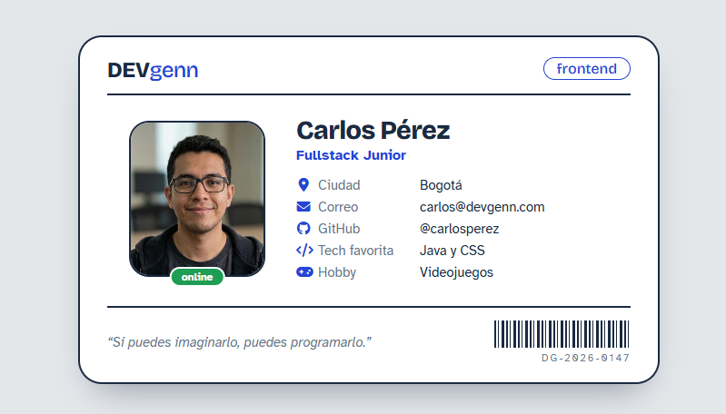

# Credencial Digital - DevGenn

Laboratorio práctico de **HTML semántico y CSS** (Box Model, Flexbox y Position) a partir de un boceto en Excalidraw.

🔗 **Demo en vivo:** [Credencial Digital - DevGenn](https://laboratorio-practico-box-model.vercel.app/)

## Qué incluye

- **HTML semántico:** `<article>`, `<header>`, `<main>`, `<footer>` y lista de descripción (`<dl>`, `<dt>`, `<dd>`) para alinear etiquetas y valores.
- **Box Model:** `box-sizing: border-box`, control de dimensiones, bordes y `border-radius`.
- **Flexbox:** centrado en pantalla y distribución interna con `gap`.
- **Position:** insignia `frontend` flotante con `position: absolute` dentro de `.credencial` (`position: relative`).
- **Bonus CSS:** etiqueta `online` generada con `::after` sin modificar el HTML, y código de barras dibujado con `repeating-linear-gradient`.
- **Recursos externos:** Google Fonts (*Bricolage Grotesque* y *Atkinson Hyperlegible*) e iconos de Font Awesome.
